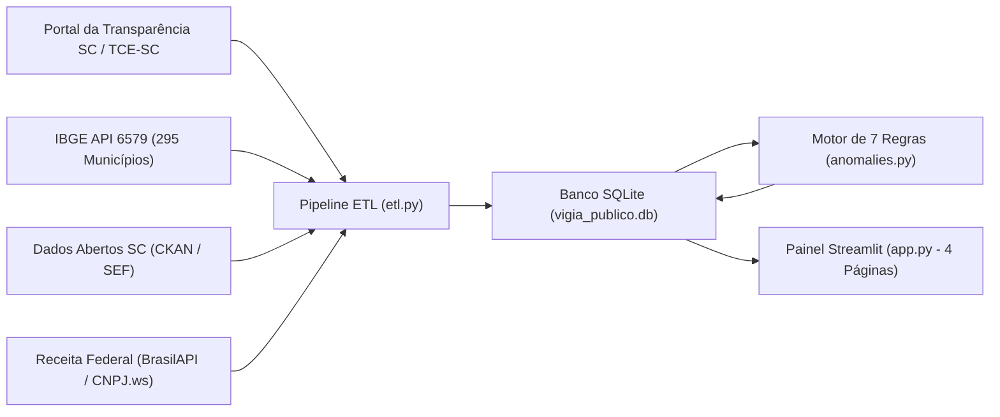
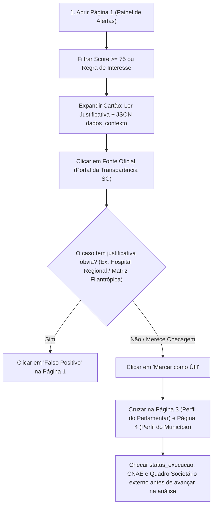

# 🔍 Guia Completo de Uso e Interpretação de Dados no Streamlit — Vigia Público SC

Este manual explica passo a passo como operar o painel interativo em [app.py](file:///C:/Users/titoc/OneDrive/Documentos/vigia-publico/app.py) e, principalmente, **como ler, cruzar e interpretar com rigor técnico e documental** cada métrica, tabela, gráfico e alerta gerado pelo **Vigia Público SC**.

> [!IMPORTANT]
> **Premissa Ética Fundamental:** Os alertas e indicadores do painel **não são provas de irregularidade, fraude ou corrupção**. Eles apontam desvios estatísticos ou características cadastrais atípicas em dados públicos oficiais que funcionam como **ponto de partida para análise técnica, verificação documental e contraditório**.

---

## 1. De Onde Vêm os Dados que Você Vê na Tela?

Antes de interpretar qualquer número no Streamlit, é essencial saber como cada dado chega até a interface. Ao abrir o painel, a função [`carregar_dados_painel`](file:///C:/Users/titoc/OneDrive/Documentos/vigia-publico/app.py#L22-L39) lê o banco local SQLite (`data/vigia_publico.db`), que consolida quatro fontes públicas oficiais:



| Fonte Oficial | O que fornece ao painel | Onde impacta na leitura |
| :--- | :--- | :--- |
| **Portal da Transparência SC / SIGEF e TCE/SC** | Código da emenda (`2026EP...`), autor (deputado ou bancada), valor, município, área temática, entidade/credor, CNPJ, data e status de execução. | Todas as tabelas de emendas, somatórios e links diretos de auditoria (`fonte_url`). |
| **IBGE (Agregado 6579)** | População oficial estimada de todos os **295 municípios catarinenses** e código IBGE de 7 dígitos. | Cálculo do `valor_per_capita` (Página 2 e Página 4) e disparo da **Regra 2**. |
| **Receita Federal (BrasilAPI / CNPJ.ws)** | Data de abertura do CNPJ, capital social declarado, UF da sede e atividade econômica principal (`CNAE`). | Disparo das **Regras 5, 6 e 7** e colunas cadastrais nas tabelas de emendas. |
| **Dados Abertos SC (SEF)** | Contexto suplementar de despesas estaduais e transferências voluntárias. | Validação cruzada e rastreabilidade em `data/raw/`. |

---

## 2. Como Iniciar, Atualizar a Base e Usar Recursos Nativos

### 2.1. Executando o Painel
No terminal, na raiz do projeto, execute:

```bash
streamlit run app.py
```

O navegador abrirá automaticamente em `http://localhost:8501`.

### 2.2. Base Completa e Abrangência Territorial
O sistema opera com 100% da base oficial de emendas parlamentares do Estado de Santa Catarina (~4.292 emendas) cobrindo todos os municípios catarinenses. No Explorador de Emendas (Página 2), os gráficos de análise territorial garantem a exibição de todos os 295 municípios de Santa Catarina, permitindo visualizar com precisão tanto os polos mais contemplados quanto os municípios sem repasses no recorte.

### 2.3. Atalhos Escondidos nas Tabelas do Streamlit (`st.dataframe`)
Em qualquer uma das 5 páginas, ao passar o mouse sobre o canto superior direito de uma tabela interativa, você tem acesso a três ferramentas nativas muito úteis:
1. **Ordenar por qualquer coluna:** clique diretamente sobre o nome da coluna (ex.: clique em `valor_per_capita` uma vez para ordem crescente e duas vezes para ver os maiores no topo).
2. **Busca rápida (`🔍`):** clique na lupa da tabela (ou pressione `Ctrl + F` com a tabela selecionada) para procurar um sobrenome, palavra, CNPJ ou código `2026EP...`.
3. **Exportar CSV (`⬇️`):** baixe exatamente o recorte filtrado na tela para abrir no Excel ou Google Sheets.

### 2.4. Identidade Visual de Inteligência & Investigação Cívica (Dark Mode)
A interface adota a estética de **Painel de Inteligência / Sala de Situação Investigativa** (inspirado no padrão Bloomberg e ProPublica):
* **Paleta Dark Mode de Alto Contraste:** fundo grafite escuro (`#0E1117` e `#161B22`), texto nítido em branco-gelo (`#E6EDF3`) e detalhes em ciano elétrico investigativo (`#00B4D8`).
* **Cartões de Métricas (KPIs) Iluminados:** cartões com borda de acento ciano superior (`border-top: 3px solid #00B4D8`), fundo com leve gradiente translúcido, elevação ao passar o cursor e números renderizados em tipografia monoespaçada técnica (`JetBrains Mono`).
* **Tags e Badges Semânticos:** `.badge-green` (regular), `.badge-yellow` (atenção cadastral), `.badge-red` (alto risco/anomalia severa) e `.badge-cyan` (fontes oficiais).
* **Arquitetura de Estilo:** configurada nativamente em `.streamlit/config.toml` (evitando qualquer *flicker* claro/escuro) combinada com a injeção modular de `assets/style.css` pela função [`carregar_estilos_customizados`](file:///C:/Users/titoc/OneDrive/Documentos/vigia-publico/app.py#L1285-L1295).

### 2.5. Arquitetura de Alta Performance e Caching Inteligente
Para garantir respostas instantâneas ao alternar entre páginas, filtros e municípios, o sistema implementa:
1. **Cache de Dados em Memória (`@st.cache_data`):**
   * A base consolidada de 4.176 emendas, agregados e alertas é mantida em memória RAM, eliminando leituras repetitivas do SQLite a cada clique.
   * As análises analíticas de perfil de parlamentar ([`obter_dados_perfil_parlamentar`](file:///C:/Users/titoc/OneDrive/Documentos/vigia-publico/app.py)), perfil municipal ([`obter_dados_perfil_municipio`](file:///C:/Users/titoc/OneDrive/Documentos/vigia-publico/app.py)) e fluxo de recursos ([`check_fund_usage`](file:///C:/Users/titoc/OneDrive/Documentos/vigia-publico/fund_tracker.py)) são cacheadas por até 30 minutos.
2. **Invalidação Automática por Timestamp do Banco (`mtime`):**
   * Qualquer alteração no banco SQLite (`data/vigia_publico.db`), seja por nova coleta ou reprocessamento do ETL, invalida o cache automaticamente sem intervenção manual.
3. **Cache de Processo em Validação de CNPJs:**
   * Evita repetição de DDLs de tabelas SQLite e armazena os 1.200+ fornecedores em dicionário Python de processo (`_MEM_CACHE_CNPJ`), reduzindo o tempo de verificação de fluxo de recursos de ~0.50s para menos de 0.005s por consulta.
4. **Configurações de Servidor (`fastReruns` e `enableStaticServing`):**
   * Em `.streamlit/config.toml`, a opção `fastReruns = true` descarta execuções intermediárias obsoletas quando o usuário interage rapidamente com múltiplos filtros.
5. **Botão de Recarga Forçada:**
   * No cabeçalho superior (topbar), o botão **`🔄 Limpar Cache`** permite que o usuário limpe instantaneamente toda a memória de trabalho e recarregue os dados mais recentes do disco.

---

## 3. Guia Módulo por Módulo: Como Usar e Como Interpretar

O menu horizontal de abas no topo da aplicação (`st.tabs`) divide a navegação em **5 módulos investigativos complementares**, aproveitando 100% da largura da tela sem obstruções de barra lateral:
1. `🚨 1. Central de Alertas`: Mesa de triagem e priorização das 2 novas regras estatísticas oficiais.
2. `📊 2. Explorador de Emendas`: Tabela geral de emendas com filtros dinâmicos, métricas per capita e gráficos territoriais.
3. `🏛️ 3. Perfil do Parlamentar`: Detalhamento individual de deputados e bancadas regionais com histogramas e repasses por CPF/CNPJ.
4. `🏙️ 4. Perfil do Município`: Radiografia orçamentária do município com 5 gráficos analíticos e cruzamento per capita.
5. `🔍 5. Rastreabilidade & Fluxo de Recursos (TCE/SC)`: Auditoria de ponta a ponta do ciclo orçamentário e planos de trabalho.

---

### 🚨 Página 1 — Painel de Alertas e Análise de Risco
Implementada em [`renderizar_pagina_painel_alertas`](file:///C:/Users/titoc/OneDrive/Documentos/vigia-publico/app.py#L166-L225), esta é a **mesa de triagem de prioridades**. Ela lista todos os casos em que uma ou mais regras matemáticas ou cadastrais foram acionadas.

#### Como usar os 4 filtros superiores
* **Regra / Tipo de Padrão:** isola uma hipótese específica (ex.: ver apenas *Capital Social Baixo* ou *Discrepância Geográfica*).
* **Parlamentar:** filtra alertas ligados a um deputado específico ou a uma bancada regional (ex.: `BANCADA DA SERRA`).
* **Município:** foca nos alertas de uma cidade específica.
* **Pontuação Mínima (Slider 0 a 100):** **vem configurado por padrão em `60`**. Caso queira inspecionar alertas de menor intensidade (se houver após futuras calibragens), arraste o controle para `0`.

> [!NOTE]
> **Uma mesma emenda pode aparecer mais de uma vez na Página 1!** Se uma emenda de R$ 7,5 milhões para um município pequeno superar ao mesmo tempo o Percentil 95 estadual (Regra 1) e o limite de Valor Per Capita (Regra 2), ela gerará **dois alertas independentes**, cada um explicando um ângulo distinto do fenômeno.

#### Como ler a tabela e os cartões expansíveis (`🔍 Ver Detalhes e Calibrar Regras`)
A tabela é ordenada primeiro por **`pontuacao` (decrescente)** e, em caso de empate, pelo **`valor` financeiro (decrescente)**. Abaixo da tabela, clique em qualquer cartão para abrir o dossiê técnico daquele alerta:

1. **Justificativa Técnica:** frase em linguagem natural com os números exatos do desvio e o lembrete ético padrão.
2. **Beneficiário / Fornecedor e CNPJ:** mostra quem recebeu ou executou o recurso. Observe se o CNPJ pertence a um **órgão público** (Município / Fundo Municipal de Saúde) ou a uma **entidade privada / OSC / instituto / empresa**.
3. **Fonte Oficial (`fonte_url`):** link clicável direto para o extrato oficial da emenda no Portal da Transparência SC (`.../extratoemenda/?nuemendaparlamentarfiltro[]=2026EP...`). **Sempre abra este link antes de publicar qualquer matéria.**
4. **Hash de Auditoria SHA-256 (`hash_auditoria`):** código criptográfico único gerado em [`gerar_hash_auditoria`](file:///C:/Users/titoc/OneDrive/Documentos/vigia-publico/anomalies.py#L22-L25) a partir dos dados centrais do alerta.
   * *Como interpretar:* se na semana seguinte o hash mudar para o mesmo caso, significa que algum dado oficial subjacente (como valor pago ou fornecedor) sofreu alteração no portal do governo.
5. **Bloco JSON (`dados_contexto`):** é a **memória de cálculo aberta** do alerta (ex.: qual era a média estadual no dia do cálculo, qual foi o Z-score exato, quantos dias de vida tinha o CNPJ).
6. **Botões de Calibragem (`👍 Marcar como Útil` / `⚠️ Falso Positivo`):**
   * Gravam sua avaliação na tabela `alertas_feedback` via [`registrar_feedback_local`](file:///C:/Users/titoc/OneDrive/Documentos/vigia-publico/app.py#L133-L163).
   * Os contadores de avaliações são preservados mesmo quando o pipeline é rodado novamente, pois são vinculados ao `hash_auditoria`. Use **Falso Positivo** quando confirmar que há uma explicação legítima óbvia (ex.: hospital regional atendendo 15 cidades vizinhas).

---

### 📊 Página 2 — Explorador de Emendas Parlamentares
Implementada em [`renderizar_pagina_explorador_emendas`](file:///C:/Users/titoc/OneDrive/Documentos/vigia-publico/app.py#L227-L287), permite investigar **toda a base limpa (`emendas_clean`)**, inclusive emendas que **não** geraram alertas.

#### Como ler os 4 indicadores (KPIs) de topo
* **Total Filtrado:** soma financeira bruta (`R$`) apenas das emendas que passaram pelos seus filtros atuais.
* **Quantidade de Emendas:** número de instrumentos/extratos individuais no recorte.
* **Municípios Contemplados:** contagem de códigos IBGE distintos atingidos pelo filtro (útil para medir capilaridade territorial de um deputado ou de uma área como *Saúde*).
* **Valor Total / População:** razão per capita global do recorte ativo, obtida pela divisão do valor total filtrado pela soma das populações únicas dos municípios contemplados (sem duplicidade).

#### Dicionário de Interpretação das Colunas da Tabela

| Coluna | O que significa | Como interpretar corretamente (Pegadinhas comuns) |
| :--- | :--- | :--- |
| `id_emenda` | Código oficial no SIGEF/Transparência (ex.: `2026EP003596`). | Os 4 primeiros dígitos indicam o exercício (`2026`). Use este código para pedidos via Lei de Acesso à Informação (LAI). |
| `parlamentar` | Autor da emenda impositiva. | Inclui tanto **Deputados Estaduais individuais** quanto **Bancadas Regionais** (ex.: `BANCADA DA SERRA`, `BANCADA DO OESTE`), que naturalmente movimentam valores maiores. |
| `partido` | Sigla partidária associada ao autor. | Em emendas coletivas de bancada, pode aparecer como bancada/pluripartidário ou vazio conforme o extrato. |
| `municipio` | Localidade de destino do recurso. | **Atenção:** Quando a emenda tem escopo estadual (ex.: órgãos estaduais ou fundos estaduais), aparece normalizada para a referência estadual (`codigo_ibge` `4200000`). |
| `populacao` | População residente oficial do município (IBGE). | Base demográfica utilizada para o cálculo do impacto per capita local e regional. |
| `area` | Função orçamentária / área temática. | Ex.: `Saúde`, `Educação`, `Infraestrutura e Mobilidade`, `Agricultura`, `Segurança Pública`, `FUNDO SOCIAL`. |
| `valor` | Valor financeiro da emenda em reais (`R$`). | Verifique sempre a coluna `status_execucao` ao lado para saber se esse valor já saiu do caixa ou se é apenas previsão/empenho! |
| `valor_per_capita` | `valor` daquela emenda dividido pela população IBGE do município. | Mede o **impacto individual daquela única emenda** por habitante na cidade destino (não é a soma de todas as emendas do município — essa soma está na Página 4). |
| `entidade_beneficiaria` | Entidade ou órgão destinatário da alocação. | Frequentemente coincide com o credor, mas pode indicar o fundo/município recebedor do convênio. |
| `fornecedor_nome` | Razão social oficial do credor/beneficiário vinculada ao CNPJ. | Nome enriquecido/validado junto à base cadastral da Receita Federal. |
| `fornecedor_cnpj` | CNPJ de 14 dígitos (apenas números). | Chave primária para checar quadro societário (`QSA`), contratos anteriores e sanções (CEIS/CNEP). |
| `status_execucao` | Estágio contábil da despesa pública. | **Crucial para não errar na matéria** — veja a tabela de estágios orçamentários logo abaixo. |
| `data` | Data de referência/registro no formato `AAAA-MM-DD`. | Usada para medir concentração mensal (Regra 4) e tempo de vida do CNPJ na data da emenda (Regra 5). |

> [!WARNING]
> **Cuidado Metodológico com `status_execucao` (Direito Financeiro Público):** Nunca conclua que uma entidade *"já recebeu na conta"* sem checar esta coluna!
> * **Aprovado:** a emenda foi autorizada no orçamento, mas a reserva de pagamento pode ainda estar em tramitação documental.
> * **Empenhado:** o Estado reservou o dinheiro no orçamento para aquele credor (há compromisso formal), mas o serviço/entrega ainda não foi atestado nem pago.
> * **Liquidado:** o órgão público já verificou que o bem foi entregue ou a etapa cumprida e reconheceu a dívida líquida, aguardando apenas a transferência bancária.
> * **Pago:** o dinheiro efetivamente saiu dos cofres estaduais (ordem bancária emitida).

#### Como ler os Gráficos Analíticos da Página 2
Abaixo da tabela de dados, o Explorador disponibiliza 5 visualizações gráficas segmentadas que refletem os filtros selecionados:
* **👤 Total por Parlamentar Individual (R$):** ranking financeiro dos parlamentares individuais (exclui bancadas), permitindo comparar cotas de mandatos específicos.
* **🏛️ Total por Bancada Regional (R$):** ranking financeiro exclusivo das bancadas regionais (iniciadas por `BANCADA `), permitindo avaliar o volume dos blocos suprapartidários regionais.
* **📈 Valor Total / População por Município (R$ / hab):** indicador per capita que relaciona o total destinado à população residente dos municípios contemplados, destacando municípios com alta concentração proporcional de recursos.
* **📋 Número Total de Emendas por Autor:** volume quantitativo de emendas/instrumentos alocados por cada parlamentar ou bancada (útil para diagnosticar estratégias de pulverização de repasses).
* **🏙️ Total Financeiro por Município (R$):** ranking dos municípios catarinenses que mais receberam recursos no recorte filtrado.

---

### 🏛️ Página 3 — Perfil do Parlamentar e Bancadas Regionais
Implementada em [`renderizar_pagina_perfil_parlamentar`](file:///C:/Users/titoc/OneDrive/Documentos/vigia-publico/app.py#L387-L485), entrega um raio-X consolidado com **verificação estritamente separada** entre Deputados Individuais e Bancadas Regionais:

#### 1. Verificação Separada (Parlamentar Individual vs. Bancada Regional)
No topo da página, um seletor de categoria permite isolar a análise:
* **Parlamentar Individual:** lista os 40 deputados estaduais da ALESC, permitindo avaliar a cota e atuação individual de cada mandato.
* **Bancada Regional:** lista as 6 bancadas regionais (Serra, Norte, Oeste, Sul, Vale do Itajaí e Grande Florianópolis), que articulam recursos coletivos para intervenções regionais estruturantes.

#### 2. Como interpretar os 4 KPIs do Perfil
1. **Total Destinado:** volume global somado de todas as emendas daquele autor na base.
2. **Nº de Emendas:** permite deduzir a estratégia de atuação (pulverização vs. concentração).
3. **Área Principal:** área temática que recebeu a maior fatia financeira (`R$`) do parlamentar.
4. **Maior Concentração Fornecedor (`%`):** percentual canalizado para um único credor/CNPJ.

#### 3. Histogramas Comparativos Gerais na Página 3
Abaixo dos dados individuais do parlamentar, uma seção dedicada apresenta **3 abas com histogramas gerais** cobrindo todo o orçamento estadual:
* **🏛️ Histograma por Partido Político:** soma o valor total destinado por cada legenda (MDB, PL, PSD, PT, PP, etc.) e sua participação percentual relativa.
* **👤 Histograma por Autor (Parlamentar e Bancada):** ranking comparativo dos maiores empenhos financeiros, com filtro opcional para isolar apenas parlamentares individuais, apenas bancadas ou o ranking global unificado.
* **📅 Histograma por Ano de Exercício:** gráfico temporal mostrando o total alocado ano a ano no orçamento do Estado.

#### 4. Gráfico de Barras por Município Destino no Perfil do Autor
Na **Verificação Detalhada por Autor**, logo abaixo dos indicadores de topo, o gráfico de barras **Distribuição de Recursos por Município Destino (R$)** apresenta em ordem decrescente todos os municípios contemplados pelo parlamentar ou bancada selecionada, permitindo diagnosticar a concentração geográfica e os polos regionais atendidos por cada mandato.

#### 5. Gráficos de Destinações por CPF / CNPJ do Beneficiário
Na **Verificação Detalhada por Autor**, dois gráficos de barras dedicados detalham os repasses para cada favorecido (com documento devidamente formatado e nome oficial):
* **💰 Valor Total por CPF / CNPJ (R$):** ranking financeiro dos favorecidos que mais receberam recursos daquele autor no período.
* **📋 Número de Emendas por CPF / CNPJ:** quantidade de emendas/instrumentos destinados àquele mesmo CPF ou CNPJ, permitindo diagnosticar concentrações e recorrências de repasses.

#### Colunas Extras Visíveis na Tabela Inferior da Página 3 (e da Página 4)
Diferente da Página 2 (que exibe 12 colunas resumidas), a tabela final das Páginas 3 e 4 exibe **todas as 21 colunas de `emendas_clean`**, revelando dados riquíssimos da Receita Federal:
* `uf_fornecedor`: estado da sede do CNPJ (ex.: `SC`, `SP`, `PR`).
* `data_abertura_fornecedor`: data em que o CNPJ foi aberto na Receita Federal.
* `capital_social_fornecedor`: capital social em reais declarado no contrato social.
* `cnae_fornecedor`: atividade econômica oficial da empresa/entidade — **verifique sempre se o CNAE faz sentido com a `area` da emenda** (ex.: empresa de eventos ou comércio varejista recebendo verba de saúde ou infraestrutura).

---

### 🗺️ Página 4 — Perfil do Município Catarinense
Implementada em [`renderizar_pagina_perfil_municipio`](file:///C:/Users/titoc/OneDrive/Documentos/vigia-publico/app.py), consolida todos os **295 municípios de Santa Catarina** (identificados por nome e código oficial IBGE, ex.: `Florianópolis (4205407)`), integrando visões macroestaduais e análises locais detalhadas.

#### 1. Panorama Geral: Macrorregião (IBGE) ou Município
No topo da página, um seletor dinâmico permite comparar a distribuição orçamentária estadual:
* **Macrorregião (IBGE):** agrupa todos os 295 municípios nas 6 macrorregiões (mesorregiões) oficiais do IBGE:
  * *Grande Florianópolis*, *Norte Catarinense*, *Oeste Catarinense*, *Serrana*, *Sul Catarinense* e *Vale do Itajaí*.
  * **Gráfico 1:** Valor total das emendas (R$) por Macrorregião.
  * **Gráfico 2:** Número total de emendas por Macrorregião.
* **Município:** exibe o ranking comparativo de todos os municípios catarinenses:
  * **Gráfico 1:** Maiores alocações financeiras acumuladas por município.
  * **Gráfico 2:** Maiores volumes quantitativos de emendas por município.

#### 2. Indicadores do Município Selecionado (KPIs de Topo)
* **População (IBGE):** população residente oficial utilizada como denominador per capita.
* **Total Recebido:** volume financeiro bruto somado de todas as emendas destinadas ao município.
* **Valor Per Capita:** acumulado municipal per capita ($\frac{\text{Total Recebido}}{\text{População}}$).
* **Emendas Recebidas:** quantidade de instrumentos alocados para o município.

#### 3. Gráficos Analíticos Detalhados (Antes dos Alertas)
Para o município selecionado, o painel gera 8 visualizações estatísticas antes da lista de alertas:
1. **Áreas Temáticas Beneficiadas:**
   * **1.1 Total em Reais (R$) por Área:** ranking financeiro das funções orçamentárias (Saúde, Educação, Infraestrutura, Agricultura, etc.).
   * **1.2 Número de Emendas por Área:** contagem de instrumentos destinados a cada área temátíca.
2. **Parlamentares e Emendas Individuais:**
   * **2.1 Soma Total de Valor por Deputado (R$):** ranking dos parlamentares que mais destinaram recursos ao município.
   * **2.2 Soma Total do Valor por Emenda Individual (R$):** identificação e valor de cada emenda destinada ao município.
3. **Distribuição por Partido Político:**
   * **3.1 Valor Total por Partido (R$):** volume financeiro repassado por cada legenda partidária.
   * **3.2 Número de Emendas por Partido:** contagem quantitativa de emendas por legenda partidária.
4. **Favorecidos por CNPJ — Valor Total (Top 50 Maiores):**
   * Gráfico de barras com os 50 maiores credores/beneficiários por valor financeiro total recebido no município, com CNPJ formatado e razão social.
5. **Favorecidos por CNPJ — Maior Emenda Individual (Top 50 Maiores):**
   * Gráfico de barras com a maior emenda individual alocada para cada um dos 50 principais CNPJs beneficiários no município.
   * Tabela expansível com o resumo cadastral e percentual de participação de cada favorecido.

#### 4. Como interpretar os dados municipais
* **Municípios com R$ 0,00:** como [`construir_agregados_municipio`](file:///C:/Users/titoc/OneDrive/Documentos/vigia-publico/etl.py#L98-L151) cruza com o censo completo do IBGE, municípios que não receberam nenhuma emenda no recorte atual também aparecem na lista com `Total Recebido = R$ 0.00` e `0 emendas`. Isso permite descobrir quais cidades ficaram desassistidas na amostra analisada.
* **Diferença entre os dois cálculos de `Valor Per Capita` no sistema:**
  * Na **Página 4 (KPI de topo)**, `Valor Per Capita` é o **acumulado municipal**: $\frac{\text{Soma de todas as emendas do município}}{\text{População IBGE}}$.
  * Na **Página 2 e na Regra 2**, `valor_per_capita` é calculado **por emenda individual**: $\frac{\text{Valor de uma única emenda}}{\text{População IBGE}}$.
* **Efeito Demográfico:** municípios com menos de 5.000 habitantes (muito comuns no Oeste e Meio-Oeste catarinense, como Vargem, Santiago do Sul ou Lajeado Grande) terão valores *per capita* naturalmente elevados quando recebem uma obra de pavimentação ou unidade de saúde de R$ 1 milhão — pois o custo mínimo de uma obra pública não encolhe na mesma proporção da população.

---

### 🔄 Página 5 — Rastreabilidade & Fluxo de Recursos (TCE/SC & e-Sfinge)
Implementada em [`renderizar_pagina_fluxo_recursos`](file:///C:/Users/titoc/OneDrive/Documentos/vigia-publico/app.py) e apoiada pelo módulo [`fund_tracker.py`](file:///C:/Users/titoc/OneDrive/Documentos/vigia-publico/fund_tracker.py), permite auditar o fluxo dos recursos públicos de ponta a ponta para verificar se as verbas recebidas pelos municípios cumpriram a finalidade pactuada e as exigências do TCE/SC:

#### 1. As 5 Dimensões Técnicas de Verificação de Conformidade
1. **Objeto do Plano de Trabalho:**
   * Medida cautelar do TCE/SC determina a suspensão de repasses que não possuam plano de trabalho prévio com objeto claro, metas e cronograma.
   * O sistema cruza os termos descritos no objeto com a área temátíca da emenda (Saúde, Educação, Infraestrutura, etc.).
2. **Prestação de Contas no Sistema e-Sfinge:**
   * O TCE/SC consolida as declarações contábeis municipais no e-Sfinge. Verifica se o recurso repassado já conta com ateste e liquidação formal registrada.
3. **Ritmo de Execução Orçamentária:**
   * Compara a data de cadastro da emenda com o estágio contábil (`Pago`, `Liquidado`, `Empenhado`, `Aprovado`). Sinaliza emendas aprovadas há mais de 12 meses sem movimentação financeira.
4. **Qualificação Cadastral do Fornecedor / Credor:**
   * Integração com o módulo de validação em 3 camadas de CNPJs: verifica se a empresa contratada está ativa perante a Receita Federal, se é um Empresário Individual (código 2135) recebendo valor expressivo (> R$ 500k), ou se possui capital social desproporcional.
5. **Transparência Ativa Municipal:**
   * Mapeia os canais de transparência do município e gera links diretos para conferência das ordens de empenho e notas fiscais.

#### 2. Links Oficiais para Verificação Manual sem Juízos Conclusivos
Para permitir que jornalistas e cidadãos realizem auditoria direta sem intermediários, cada emenda apresenta links oficiais:
* 🔗 **Painel TCE/SC — Fluxo de Recursos:** rastreamento de ponta a ponta desde a aprovação até o beneficiário final.
* 🔗 **Sistema e-Sfinge do TCE/SC:** consulta a declarações e balancetes municipais.
* 🔗 **Medida Cautelar TCE/SC:** termos da decisão sobre obrigatoriedade de planos de trabalho.
* 🔗 **Portal de Transparência Municipal:** canal oficial da prefeitura executora.
* 🔗 **Consulta de CNPJ no Gov.br:** certidão de situação cadastral e quadro societário da Receita Federal.

---

## 4. Manual de Interpretação dos Novos Alertas Estatísticos e Pontuações

Os alertas do sistema foram reformulados para focar em critérios objetivos de desvio padrão estatístico (+1 STD) e foram **unificados exclusivamente na aba "1. Central de Alertas"** (sendo removidos das páginas de perfil do parlamentar e perfil do município para manter a visualização focada).

| # | Código Interno | Nome no Painel | Gatilho Objetivo (Critérios Estatísticos) | Faixa de Score |
| :-: | :--- | :--- | :--- | :---: |
| **1** | `REGRA_1_TRIPLO_DESVIO_VALOR_PER_CAPITA_AREA` | **Triplo Desvio: Valor, Per Capita e Área** | Cumpre cumulativamente 3 requisitos: (1) Valor $>$ Média global $+ 1\sigma$; (2) Município com valor per capita recebido elevado ($> \text{Média} + 1\sigma$); (3) Valor na respectiva área temática $>$ Média setorial $+ 1\sigma$. | `80.0` a `100.0` |
| **2** | `REGRA_2_VALOR_AREA_ACIMA_MEDIA_1STD` | **Valor na Área Acima da Média + 1 STD** | Valor de uma emenda específica para uma área temática $>$ Média daquela área $+ 1\sigma$ setorial (calculado para todas as áreas temáticas). | `70.0` a `100.0` |

### Como interpretar cada um dos novos alertas

#### 1. Triplo Desvio: Valor, Per Capita e Área (`REGRA_1_TRIPLO_DESVIO_VALOR_PER_CAPITA_AREA`)
* **Cálculo do Score:** parte de `80.0` pontos (por exigir o cumprimento estrito de 3 filtros de exceção simultâneos) e sobe até `100.0` conforme a magnitude conjunta dos desvios padrão da emenda frente ao Estado e à área setorial.
* **Os 3 Requisitos Exigidos Simultaneamente:**
  1. **Valor Absoluto da Emenda:** a emenda individual é superior à média de todas as emendas de SC mais 1 desvio padrão ($\text{Valor} > \mu_{\text{global}} + \sigma_{\text{global}}$).
  2. **Impacto Per Capita no Município:** o município destinatário apresenta alocação per capita elevada, seja pelo impacto da própria emenda sobre a população local ou pelo acumulado de repasses por habitante superior à média estadual mais 1 desvio padrão.
  3. **Relevância Setorial na Área:** o valor da emenda supera a média mais 1 desvio padrão da respectiva função temática (Saúde, Educação, Infraestrutura, Agricultura, etc.).
* **O que auditar:** por se tratar de um repasse de grande vulto financeiro destinado a um município onde o impacto proporcional por morador é extremo e que simultaneamente lidera a faixa de valores daquela área temátíca, recomenda-se verificar o plano de trabalho, os termos do convênio e a capacidade técnica de execução.

#### 2. Valor na Área Acima da Média + 1 STD (`REGRA_2_VALOR_AREA_ACIMA_MEDIA_1STD`)
* **Cálculo do Score:** parte de `70.0` pontos quando o valor da emenda ultrapassa o limiar de 1 desvio padrão da sua respectiva área temática ($Z_{\text{setorial}} > 1.0$), escalando até `100.0` para desvios ainda mais pronunciados.
* **Gatilho Setorial:** cada área temática (ex.: *Saúde*, *Educação*, *Infraestrutura e Mobilidade*, *Agricultura*, *Segurança Pública*, *Fundo Social*) possui sua própria média e desvio padrão. A regra identifica as emendas que são pontos fora da curva dentro do seu próprio segmento dentre todas as áreas da administração estadual.
* **O que auditar:** verificar se o objeto pactuado (aquisição de maquinário, pavimentação, reformas de unidades escolares ou hospitalares) possui justificativa orçamentária compatível com a média de custos praticada no setor.

---

### 4.1 Validação Cadastral de CNPJs em 3 Camadas (Padrão TCU)

Para auditar os favorecidos e credores cadastrados na base de emendas, o sistema implementa em [`cnpj_validator.py`](file:///C:/Users/titoc/OneDrive/Documentos/vigia-publico/cnpj_validator.py) uma arquitetura de verificação em 3 camadas inspirada em recomendações do Tribunal de Contas da União (TCU):

#### 1ª Camada: Verificação da Situação Cadastral
A situação cadastral perante a Receita Federal é o filtro primário de idoneidade jurídica da entidade:
* **🟢 Ativa:** operação cadastral regular (passa na validação).
* **🔴 Baixada:** empresa encerrada ainda recebendo emendas parlamentares (alerta severo).
* **🔴 Inapta:** empresa omissa em declarações fiscais por mais de 2 anos ou não localizada (notas fiscais e certidões podem ser inválidas).
* **🟡 Suspensa:** empresa temporariamente suspensa por pendências cadastrais ou judiciais (requer verificação manual).
* **🔴 Nula:** inscrição no CNPJ declarada nula por fraude ou vício insanável.

#### 2ª Camada: Indicadores de Anomalias Cadastrais TCU
Além do status cadastral, o sistema combina dados societários e contratuais para gerar tags e scores de suspeita:
1. **Empresa Recém-Criada (`< 180 dias`):** empresas com data de abertura inferior a 6 meses antes da data da emenda. Aponta risco de baixa capacidade técnica e operacional para executar obras ou serviços públicos.
2. **Empresário Individual (EI 2135) com Alto Valor (`> R$ 500.000`):** apontamento destacado pelo TCU, que identificou distorções em que empresários individuais sem quadro societário complexo recebem emendas de grande vulto incompatíveis com seu porte.
3. **CNAE Incompatível com a Área da Emenda:** inconsistência entre a atividade econômica principal declarada na Receita Federal e a destinação temática da verba (ex.: empresa de construção civil ou eventos recebendo recursos de Saúde).
4. **Capital Social Baixo (`< R$ 10.000`) com Emenda Expressiva (`>= R$ 200.000`):** sinaliza descompasso patrimonial que exige confirmação de capacidade instalada e garantias financeiras.

#### 3ª Camada: Cache Local Persistente (`cnpj_cache`) e Consulta Direta no Gov.br
* **Tabela `cnpj_cache`:** armazena localmente no SQLite o histórico de consultas de todos os fornecedores das emendas, garantindo respostas em milissegundos sem depender de cotas de APIs externas.
* **Link Direto Gov.br / Portal da Transparência:** cada CNPJ exibido na Central de Alertas e nos Perfis conta com link oficial direto para conferência pública gratuita e sem necessidade de login.

---

## 5. Roteiro Prático de Análise e Verificação no Painel (Workflow Recomendado)

Use o fluxo abaixo para transformar os dados do Streamlit em checagem técnica e documental sólida sem cair em conclusões precipitadas:



### Três Exercícios Rápidos de Uso Cruzado
1. **Encontrar "cidades-espelho" para comparar distorções:**
   * Viu na **Página 1** um alerta de *Valor Per Capita Alto* num município de 10 mil habitantes? Vá à **Página 4**, anote o total recebido e selecione outros dois municípios da mesma microrregião com população parecida (~10 mil hab.) para comparar quanto eles receberam no mesmo período.
2. **Auditar a coerência temática de um fornecedor:**
   * Na **Página 3**, escolha um parlamentar e role até a tabela completa de emendas. Compare lado a lado as colunas `area` (ex.: *Saúde* ou *Educação*) e `cnae_fornecedor` (atividade econômica na Receita Federal). Divergências entre o objeto da emenda e o ramo da entidade são excelentes pistas de verificação documental.
3. **Separar promessa política de dinheiro efetivamente pago:**
   * Na **Página 2**, filtre um parlamentar ou município e ordene pela coluna `status_execucao`. Compare a soma do que está apenas `Aprovado` ou `Empenhado` com o que já consta como `Liquidado` ou `Pago`. Isso permite cobrar tanto parlamentares quanto o Executivo estadual sobre gargalos reais na liberação das verbas.
