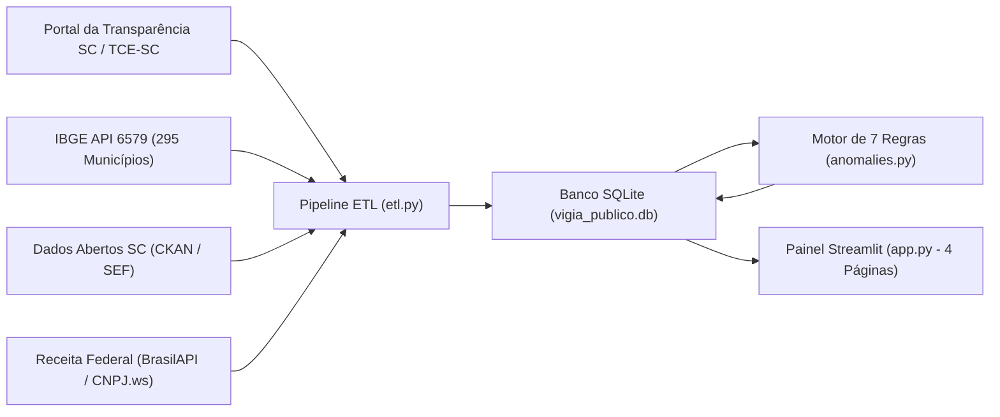
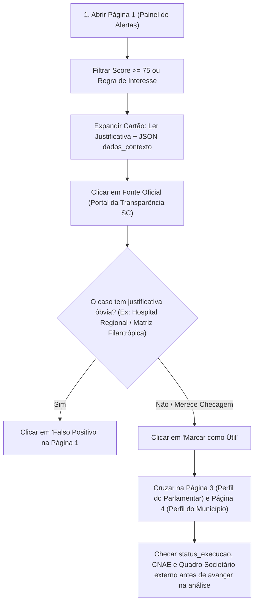

# 🔍 Guia Completo de Uso e Interpretação de Dados no Streamlit — Vigia Público SC

Este manual explica passo a passo como operar o painel interativo em [app.py](file:///C:/Users/titoc/OneDrive/Documentos/vigia-publico/app.py) e, principalmente, **como ler, cruzar e interpretar com rigor técnico e documental** cada métrica, tabela, gráfico e alerta gerado pelo **Vigia Público SC**.

> [!IMPORTANT]
> **Premissa Ética Fundamental:** Os alertas e indicadores do painel **não são provas de irregularidade, fraude ou corrupção**. Eles apontam desvios estatísticos ou características cadastrais atípicas em dados públicos oficiais que funcionam como **ponto de partida para análise técnica, verificação documental e contraditório**.

---

## 1. De Onde Vêm os Dados que Você Vê na Tela?

Antes de interpretar qualquer número no Streamlit, é essencial saber como cada dado chega até a interface. Ao abrir o painel, a função [`carregar_dados_painel`](file:///C:/Users/titoc/OneDrive/Documentos/vigia-publico/app.py#L22-L39) lê o banco local SQLite (`data/vigia_publico.db`), que consolida quatro fontes públicas oficiais:



| Fonte Oficial | O que fornece ao painel | Onde impacta na leitura |
| :--- | :--- | :--- |
| **Portal da Transparência SC / SIGEF e TCE/SC** | Código da emenda (`2026EP...`), autor (deputado ou bancada), valor, município, área temática, entidade/credor, CNPJ, data e status de execução. | Todas as tabelas de emendas, somatórios e links diretos de auditoria (`fonte_url`). |
| **IBGE (Agregado 6579)** | População oficial estimada de todos os **295 municípios catarinenses** e código IBGE de 7 dígitos. | Cálculo do `valor_per_capita` (Página 2 e Página 4) e disparo da **Regra 2**. |
| **Receita Federal (BrasilAPI / CNPJ.ws)** | Data de abertura do CNPJ, capital social declarado, UF da sede e atividade econômica principal (`CNAE`). | Disparo das **Regras 5, 6 e 7** e colunas cadastrais nas tabelas de emendas. |
| **Dados Abertos SC (SEF)** | Contexto suplementar de despesas estaduais e transferências voluntárias. | Validação cruzada e rastreabilidade em `data/raw/`. |

---

## 2. Como Iniciar, Atualizar a Base e Usar Recursos Nativos

### 2.1. Executando o Painel
No terminal, na raiz do projeto, execute:

```bash
streamlit run app.py
```

O navegador abrirá automaticamente em `http://localhost:8501`.

### 2.2. Atenção ao Tamanho da Amostra Carregada
Por padrão, se o banco ainda não existir, [`garantir_dados_iniciais`](file:///C:/Users/titoc/OneDrive/Documentos/vigia-publico/main.py#L43-L54) inicializa a base automaticamente. Na coleta padrão ([collect_tce.py](file:///C:/Users/titoc/OneDrive/Documentos/vigia-publico/collect_tce.py)), o sistema baixa o índice integral (~4.292 emendas) e detalha prioritariamente as **250 maiores/principais emendas** para rapidez de resposta.

> [!TIP]
> **Quer analisar 100% das emendas estaduais no Streamlit?** Antes de abrir o painel, rode o pipeline completo sem limite de extratos (`VIGIA_MAX_EMENDAS=0`):
> ```powershell
> $env:VIGIA_MAX_EMENDAS="0"
> python collect_tce.py
> python enrich_cnpj.py
> python etl.py
> python anomalies.py
> streamlit run app.py
> ```

### 2.3. Atalhos Escondidos nas Tabelas do Streamlit (`st.dataframe`)
Em qualquer uma das 4 páginas, ao passar o mouse sobre o canto superior direito de uma tabela interativa, você tem acesso a três ferramentas nativas muito úteis:
1. **Ordenar por qualquer coluna:** clique diretamente sobre o nome da coluna (ex.: clique em `valor_per_capita` uma vez para ordem crescente e duas vezes para ver os maiores no topo).
2. **Busca rápida (`🔍`):** clique na lupa da tabela (ou pressione `Ctrl + F` com a tabela selecionada) para procurar um sobrenome, palavra, CNPJ ou código `2026EP...`.
3. **Exportar CSV (`⬇️`):** baixe exatamente o recorte filtrado na tela para abrir no Excel ou Google Sheets.

---

## 3. Guia Página por Página: Como Usar e Como Interpretar

A barra lateral esquerda (`Navegação`) divide a análise em **4 visões complementares**:

---

### 🚨 Página 1 — Painel de Alertas e Análise de Risco
Implementada em [`renderizar_pagina_painel_alertas`](file:///C:/Users/titoc/OneDrive/Documentos/vigia-publico/app.py#L166-L225), esta é a **mesa de triagem de prioridades**. Ela lista todos os casos em que uma ou mais regras matemáticas ou cadastrais foram acionadas.

#### Como usar os 4 filtros superiores
* **Regra / Tipo de Padrão:** isola uma hipótese específica (ex.: ver apenas *Capital Social Baixo* ou *Discrepância Geográfica*).
* **Parlamentar:** filtra alertas ligados a um deputado específico ou a uma bancada regional (ex.: `BANCADA DA SERRA`).
* **Município:** foca nos alertas de uma cidade específica.
* **Pontuação Mínima (Slider 0 a 100):** **vem configurado por padrão em `60`**. Caso queira inspecionar alertas de menor intensidade (se houver após futuras calibragens), arraste o controle para `0`.

> [!NOTE]
> **Uma mesma emenda pode aparecer mais de uma vez na Página 1!** Se uma emenda de R$ 7,5 milhões para um município pequeno superar ao mesmo tempo o Percentil 95 estadual (Regra 1) e o limite de Valor Per Capita (Regra 2), ela gerará **dois alertas independentes**, cada um explicando um ângulo distinto do fenômeno.

#### Como ler a tabela e os cartões expansíveis (`🔍 Ver Detalhes e Calibrar Regras`)
A tabela é ordenada primeiro por **`pontuacao` (decrescente)** e, em caso de empate, pelo **`valor` financeiro (decrescente)**. Abaixo da tabela, clique em qualquer cartão para abrir o dossiê técnico daquele alerta:

1. **Justificativa Técnica:** frase em linguagem natural com os números exatos do desvio e o lembrete ético padrão.
2. **Beneficiário / Fornecedor e CNPJ:** mostra quem recebeu ou executou o recurso. Observe se o CNPJ pertence a um **órgão público** (Município / Fundo Municipal de Saúde) ou a uma **entidade privada / OSC / instituto / empresa**.
3. **Fonte Oficial (`fonte_url`):** link clicável direto para o extrato oficial da emenda no Portal da Transparência SC (`.../extratoemenda/?nuemendaparlamentarfiltro[]=2026EP...`). **Sempre abra este link antes de publicar qualquer matéria.**
4. **Hash de Auditoria SHA-256 (`hash_auditoria`):** código criptográfico único gerado em [`gerar_hash_auditoria`](file:///C:/Users/titoc/OneDrive/Documentos/vigia-publico/anomalies.py#L22-L25) a partir dos dados centrais do alerta.
   * *Como interpretar:* se na semana seguinte o hash mudar para o mesmo caso, significa que algum dado oficial subjacente (como valor pago ou fornecedor) sofreu alteração no portal do governo.
5. **Bloco JSON (`dados_contexto`):** é a **memória de cálculo aberta** do alerta (ex.: qual era a média estadual no dia do cálculo, qual foi o Z-score exato, quantos dias de vida tinha o CNPJ).
6. **Botões de Calibragem (`👍 Marcar como Útil` / `⚠️ Falso Positivo`):**
   * Gravam sua avaliação na tabela `alertas_feedback` via [`registrar_feedback_local`](file:///C:/Users/titoc/OneDrive/Documentos/vigia-publico/app.py#L133-L163).
   * Os contadores de avaliações são preservados mesmo quando o pipeline é rodado novamente, pois são vinculados ao `hash_auditoria`. Use **Falso Positivo** quando confirmar que há uma explicação legítima óbvia (ex.: hospital regional atendendo 15 cidades vizinhas).

---

### 📊 Página 2 — Explorador de Emendas Parlamentares
Implementada em [`renderizar_pagina_explorador_emendas`](file:///C:/Users/titoc/OneDrive/Documentos/vigia-publico/app.py#L227-L287), permite investigar **toda a base limpa (`emendas_clean`)**, inclusive emendas que **não** geraram alertas.

#### Como ler os 4 indicadores (KPIs) de topo
* **Total Filtrado:** soma financeira bruta (`R$`) apenas das emendas que passaram pelos seus filtros atuais.
* **Quantidade de Emendas:** número de instrumentos/extratos individuais no recorte.
* **Municípios Contemplados:** contagem de códigos IBGE distintos atingidos pelo filtro (útil para medir capilaridade territorial de um deputado ou de uma área como *Saúde*).
* **Valor Total / População:** razão per capita global do recorte ativo, obtida pela divisão do valor total filtrado pela soma das populações únicas dos municípios contemplados (sem duplicidade).

#### Dicionário de Interpretação das Colunas da Tabela

| Coluna | O que significa | Como interpretar corretamente (Pegadinhas comuns) |
| :--- | :--- | :--- |
| `id_emenda` | Código oficial no SIGEF/Transparência (ex.: `2026EP003596`). | Os 4 primeiros dígitos indicam o exercício (`2026`). Use este código para pedidos via Lei de Acesso à Informação (LAI). |
| `parlamentar` | Autor da emenda impositiva. | Inclui tanto **Deputados Estaduais individuais** quanto **Bancadas Regionais** (ex.: `BANCADA DA SERRA`, `BANCADA DO OESTE`), que naturalmente movimentam valores maiores. |
| `partido` | Sigla partidária associada ao autor. | Em emendas coletivas de bancada, pode aparecer como bancada/pluripartidário ou vazio conforme o extrato. |
| `municipio` | Localidade de destino do recurso. | **Atenção:** Quando a emenda tem escopo estadual (ex.: órgãos estaduais ou fundos estaduais), aparece normalizada para a referência estadual (`codigo_ibge` `4200000`). |
| `populacao` | População residente oficial do município (IBGE). | Base demográfica utilizada para o cálculo do impacto per capita local e regional. |
| `area` | Função orçamentária / área temática. | Ex.: `Saúde`, `Educação`, `Infraestrutura e Mobilidade`, `Agricultura`, `Segurança Pública`, `FUNDO SOCIAL`. |
| `valor` | Valor financeiro da emenda em reais (`R$`). | Verifique sempre a coluna `status_execucao` ao lado para saber se esse valor já saiu do caixa ou se é apenas previsão/empenho! |
| `valor_per_capita` | `valor` daquela emenda dividido pela população IBGE do município. | Mede o **impacto individual daquela única emenda** por habitante na cidade destino (não é a soma de todas as emendas do município — essa soma está na Página 4). |
| `entidade_beneficiaria` | Entidade ou órgão destinatário da alocação. | Frequentemente coincide com o credor, mas pode indicar o fundo/município recebedor do convênio. |
| `fornecedor_nome` | Razão social oficial do credor/beneficiário vinculada ao CNPJ. | Nome enriquecido/validado junto à base cadastral da Receita Federal. |
| `fornecedor_cnpj` | CNPJ de 14 dígitos (apenas números). | Chave primária para checar quadro societário (`QSA`), contratos anteriores e sanções (CEIS/CNEP). |
| `status_execucao` | Estágio contábil da despesa pública. | **Crucial para não errar na matéria** — veja a tabela de estágios orçamentários logo abaixo. |
| `data` | Data de referência/registro no formato `AAAA-MM-DD`. | Usada para medir concentração mensal (Regra 4) e tempo de vida do CNPJ na data da emenda (Regra 5). |

> [!WARNING]
> **Cuidado Metodológico com `status_execucao` (Direito Financeiro Público):** Nunca conclua que uma entidade *"já recebeu na conta"* sem checar esta coluna!
> * **Aprovado:** a emenda foi autorizada no orçamento, mas a reserva de pagamento pode ainda estar em tramitação documental.
> * **Empenhado:** o Estado reservou o dinheiro no orçamento para aquele credor (há compromisso formal), mas o serviço/entrega ainda não foi atestado nem pago.
> * **Liquidado:** o órgão público já verificou que o bem foi entregue ou a etapa cumprida e reconheceu a dívida líquida, aguardando apenas a transferência bancária.
> * **Pago:** o dinheiro efetivamente saiu dos cofres estaduais (ordem bancária emitida).

#### Como ler os Gráficos Analíticos da Página 2
Abaixo da tabela de dados, o Explorador disponibiliza 5 visualizações gráficas segmentadas que refletem os filtros selecionados:
* **👤 Total por Parlamentar Individual (R$):** ranking financeiro dos parlamentares individuais (exclui bancadas), permitindo comparar cotas de mandatos específicos.
* **🏛️ Total por Bancada Regional (R$):** ranking financeiro exclusivo das bancadas regionais (iniciadas por `BANCADA `), permitindo avaliar o volume dos blocos suprapartidários regionais.
* **📈 Valor Total / População por Município (R$ / hab):** indicador per capita que relaciona o total destinado à população residente dos municípios contemplados, destacando municípios com alta concentração proporcional de recursos.
* **📋 Número Total de Emendas por Autor:** volume quantitativo de emendas/instrumentos alocados por cada parlamentar ou bancada (útil para diagnosticar estratégias de pulverização de repasses).
* **🏙️ Total Financeiro por Município (R$):** ranking dos municípios catarinenses que mais receberam recursos no recorte filtrado.

---

### 🏛️ Página 3 — Perfil do Parlamentar e Bancadas Regionais
Implementada em [`renderizar_pagina_perfil_parlamentar`](file:///C:/Users/titoc/OneDrive/Documentos/vigia-publico/app.py#L387-L485), entrega um raio-X consolidado com **verificação estritamente separada** entre Deputados Individuais e Bancadas Regionais:

#### 1. Verificação Separada (Parlamentar Individual vs. Bancada Regional)
No topo da página, um seletor de categoria permite isolar a análise:
* **Parlamentar Individual:** lista os 40 deputados estaduais da ALESC, permitindo avaliar a cota e atuação individual de cada mandato.
* **Bancada Regional:** lista as 6 bancadas regionais (Serra, Norte, Oeste, Sul, Vale do Itajaí e Grande Florianópolis), que articulam recursos coletivos para intervenções regionais estruturantes.

#### 2. Como interpretar os 4 KPIs do Perfil
1. **Total Destinado:** volume global somado de todas as emendas daquele autor na base.
2. **Nº de Emendas:** permite deduzir a estratégia de atuação (pulverização vs. concentração).
3. **Área Principal:** área temática que recebeu a maior fatia financeira (`R$`) do parlamentar.
4. **Maior Concentração Fornecedor (`%`):** percentual canalizado para um único credor/CNPJ.

#### 3. Histogramas Comparativos Gerais na Página 3
Abaixo dos dados individuais do parlamentar, uma seção dedicada apresenta **3 abas com histogramas gerais** cobrindo todo o orçamento estadual:
* **🏛️ Histograma por Partido Político:** soma o valor total destinado por cada legenda (MDB, PL, PSD, PT, PP, etc.) e sua participação percentual relativa.
* **👤 Histograma por Autor (Parlamentar e Bancada):** ranking comparativo dos maiores empenhos financeiros, com filtro opcional para isolar apenas parlamentares individuais, apenas bancadas ou o ranking global unificado.
* **📅 Histograma por Ano de Exercício:** gráfico temporal mostrando o total alocado ano a ano no orçamento do Estado.

#### Colunas Extras Visíveis na Tabela Inferior da Página 3 (e da Página 4)
Diferente da Página 2 (que exibe 12 colunas resumidas), a tabela final das Páginas 3 e 4 exibe **todas as 21 colunas de `emendas_clean`**, revelando dados riquíssimos da Receita Federal:
* `uf_fornecedor`: estado da sede do CNPJ (ex.: `SC`, `SP`, `PR`).
* `data_abertura_fornecedor`: data em que o CNPJ foi aberto na Receita Federal.
* `capital_social_fornecedor`: capital social em reais declarado no contrato social.
* `cnae_fornecedor`: atividade econômica oficial da empresa/entidade — **verifique sempre se o CNAE faz sentido com a `area` da emenda** (ex.: empresa de eventos ou comércio varejista recebendo verba de saúde ou infraestrutura).

---

### 🗺️ Página 4 — Perfil do Município Catarinense
Implementada em [`renderizar_pagina_perfil_municipio`](file:///C:/Users/titoc/OneDrive/Documentos/vigia-publico/app.py#L319-L345), consolida todos os **295 municípios de Santa Catarina** (identificados por nome e código oficial IBGE, ex.: `Florianópolis (4205407)`).

#### Como interpretar os dados municipais
* **Municípios com R$ 0,00:** como [`construir_agregados_municipio`](file:///C:/Users/titoc/OneDrive/Documentos/vigia-publico/etl.py#L98-L151) cruza com o censo completo do IBGE, municípios que não receberam nenhuma emenda no recorte atual também aparecem na lista com `Total Recebido = R$ 0.00` e `0 emendas`. Isso permite descobrir quais cidades ficaram desassistidas na amostra analisada.
* **Diferença entre os dois cálculos de `Valor Per Capita` no sistema:**
  * Na **Página 4 (KPI de topo)**, `Valor Per Capita` é o **acumulado municipal**: $\frac{\text{Soma de todas as emendas do município}}{\text{População IBGE}}$.
  * Na **Página 2 e na Regra 2**, `valor_per_capita` é calculado **por emenda individual**: $\frac{\text{Valor de uma única emenda}}{\text{População IBGE}}$.
* **Efeito Demográfico:** municípios com menos de 5.000 habitantes (muito comuns no Oeste e Meio-Oeste catarinense, como Vargem, Santiago do Sul ou Lajeado Grande) terão valores *per capita* naturalmente elevados quando recebem uma obra de pavimentação ou unidade de saúde de R$ 1 milhão — pois o custo mínimo de uma obra pública não encolhe na mesma proporção da população.

---

## 4. Manual de Interpretação das 7 Regras de Anomalia e Pontuações

Cada regra em [anomalies.py](file:///C:/Users/titoc/OneDrive/Documentos/vigia-publico/anomalies.py) atribui uma nota de **0,0 a 100,0 pontos**. Quanto mais próximo de **100**, mais extremo é o afastamento estatístico ou cadastral em relação ao padrão esperado.

| # | Código Interno | Nome no Painel | Gatilho Objetivo | Faixa de Score |
| :-: | :--- | :--- | :--- | :---: |
| **1** | `REGRA_1_VALOR_ABSOLUTO_P95` | **Valor Absoluto Alto** | Valor da emenda $>$ Percentil 95 da base | `75.0` a `100.0` |
| **2** | `REGRA_2_PER_CAPITA_ACIMA_2DP` | **Valor Per Capita Alto** | Valor per capita $>$ Média estadual $+ 2\sigma$ (Z-score $> 2$) | `70.0` a `100.0` |
| **3** | `REGRA_3_CONCENTRACAO_FORNECEDOR_80` | **Concentração de Fornecedor** | $> 80\%$ das verbas do autor num só CNPJ ($\ge$ R$ 500 mil e $\ge 2$ emendas) | `75.0` a `100.0` |
| **4** | `REGRA_4_CONCENTRACAO_TEMPORAL_70` | **Concentração Temporal** | $> 70\%$ do valor anual do autor num único mês ($\ge$ R$ 500 mil e $\ge 2$ emendas) | `65.0` a `95.0` |
| **5** | `REGRA_5_CNPJ_RECEM_CRIADO_12M` | **Beneficiário Recém-Criado** | CNPJ aberto há menos de 12 meses antes da data da emenda | `80.0` a `100.0` |
| **6** | `REGRA_6_CAPITAL_SOCIAL_BAIXO` | **Capital Social Baixo** | Capital social entre R$ 0,01 e R$ 9.999,99 com emenda $\ge$ R$ 200 mil | `75.0` a `100.0` |
| **7** | `REGRA_7_DISCREPANCIA_GEOGRAFICA_UF` | **Discrepância Geográfica** | Sede do CNPJ fora de Santa Catarina (`UF != SC`) | `70.0` a `95.0` |

### Como interpretar cada regra na prática analítica

#### 1. Valor Absoluto Alto (`REGRA_1_VALOR_ABSOLUTO_P95`)
* **Cálculo do Score:** parte de `75` pontos e sobe até `100` conforme o múltiplo do valor sobre o limiar do Percentil 95 (`multiplo_sobre_p95` no JSON). Representa o **top 5% das emendas mais caras** do estado.
* **O que investigar:** qual é o objeto detalhado no plano de trabalho? Há estudo técnico e licitação compatível com o vulto milionário?
* **Explicação legítima comum:** emendas coletivas de **Bancadas Regionais** para grandes hospitais ou rodovias estaduais costumam liderar este ranking legitimamente.

#### 2. Valor Per Capita Alto (`REGRA_2_PER_CAPITA_ACIMA_2DP`)
* **Cálculo do Score:** mede quantos desvios padrão (`z_score` no JSON) aquela emenda está acima da média estadual por habitante. Parte de `70` (em $Z = 2,0$) e atinge `100` quando $Z \ge 4,5$.
* **O que investigar:** por que um município tão pequeno recebeu um aporte desproporcional frente aos municípios vizinhos de porte equivalente?
* **Explicação legítima comum:**
  1. **Consórcios Intermunicipais ou Hospitais Regionais:** o dinheiro cai no CNPJ sediado num município pequeno/médio (ex.: Correia Pinto), mas atende pacientes de toda a Serra Catarinense.
  2. **Indivisibilidade de obras:** construir uma ponte ou comprar uma ambulância UTI custa o mesmo num município de 2.500 habitantes ou de 500.000 habitantes.

#### 3. Concentração de Fornecedor (`REGRA_3_CONCENTRACAO_FORNECEDOR_80`)
* **Cálculo do Score:** parte de `75` pontos em $80\%$ de concentração e chega a `100` quando $100\%$ das emendas do parlamentar vão para o mesmo CNPJ. Só dispara se o parlamentar tiver pelo menos 2 emendas e somar ao menos R$ 500 mil.
* **O que investigar:** se o CNPJ concentrador for uma **OSC, instituto privado ou empresa**, investigue vínculos políticos/societários, histórico de prestação de contas e por que o mandato canaliza quase toda a sua cota para uma única entidade privada.
* **Explicação legítima comum:** parlamentar com reduto eleitoral muito concentrado que envia quase todas as suas emendas diretamente para a **Prefeitura Municipal** ou **Fundo Municipal de Saúde** da sua cidade-base.

#### 4. Concentração Temporal (`REGRA_4_CONCENTRACAO_TEMPORAL_70`)
* **Cálculo do Score:** parte de `65` pontos quando $>70\%$ do orçamento anual do deputado se concentra em um único `ano_mes` (ex.: `2026-06`), chegando a `95` em $100\%$.
* **O que investigar:** liberações aceleradas em véspera de defeso eleitoral, fim de exercício fiscal ("empenho de última hora") ou eventos políticos locais.
* **Explicação legítima comum:** janelas orçamentárias oficiais do Poder Executivo Estadual (SIGEF), nas quais o governo libera lotes inteiros de emendas impositivas de vários deputados no mesmo mês. *Dica:* se dezenas de deputados tiverem concentração no exato mesmo mês, trata-se de calendário administrativo do Estado.

#### 5. Beneficiário Recém-Criado (`REGRA_5_CNPJ_RECEM_CRIADO_12M`)
* **Cálculo do Score:** uma das regras mais sensíveis — **já começa em `80` pontos** e chega perto de `100` quanto mais próximo de zero for o intervalo `dias_entre_abertura_e_emenda` no JSON.
* **O que investigar:** entidades sem fins lucrativos ou fornecedores abertos poucos meses antes de receberem recursos públicos possuem capacidade técnica, sede física real, corpo funcional e experiência prévia comprovada?

#### 6. Capital Social Baixo (`REGRA_6_CAPITAL_SOCIAL_BAIXO`)
* **Cálculo do Score:** usa escala logarítmica sobre a razão `razao_emenda_sobre_capital` (ex.: emenda de R$ 500 mil para CNPJ com capital de R$ 3 mil = `166,7x` o capital social, gerando ~`92,8` pontos).
* **Nuance técnica importantíssima na interpretação:**
  * Na Receita Federal, órgãos públicos e a maioria das associações/fundações sem fins lucrativos possuem `capital_social = 0.0` (e por isso a regra exige `capital > 0`, evitando poluir o painel com prefeituras).
  * Porém, algumas associações/institutos registram capital simbólico (ex.: R$ 1.000 a R$ 5.000), e **empresas privadas mercantis (LTDA / SLU)** com capital abaixo de R$ 10.000 recebendo centenas de milhares de reais exigem verificação rigorosa de lastro patrimonial, sede e capacidade operacional.

#### 7. Discrepância Geográfica (`REGRA_7_DISCREPANCIA_GEOGRAFICA_UF`)
* **Cálculo do Score:** parte de `70` pontos sempre que `uf_fornecedor != SC` e escala conforme o valor financeiro (até `95` pontos).
* **O que investigar:** por que uma emenda estadual catarinense destinada a um município de SC está vinculada a um CNPJ sediado em outro estado?
* **Explicação legítima comum:** congregações filantrópicas hospitalares ou educacionais tradicionais (ex.: mantenedoras de hospitais em Itajaí ou Joinville cuja matriz histórica do CNPJ raiz `/0001-XX` fica em `SP`, `PR` ou `RS`), ou fabricantes nacionais exclusivos de equipamentos hospitalares/pesados.

---

## 5. Roteiro Prático de Análise e Verificação no Painel (Workflow Recomendado)

Use o fluxo abaixo para transformar os dados do Streamlit em checagem técnica e documental sólida sem cair em conclusões precipitadas:



### Três Exercícios Rápidos de Uso Cruzado
1. **Encontrar "cidades-espelho" para comparar distorções:**
   * Viu na **Página 1** um alerta de *Valor Per Capita Alto* num município de 10 mil habitantes? Vá à **Página 4**, anote o total recebido e selecione outros dois municípios da mesma microrregião com população parecida (~10 mil hab.) para comparar quanto eles receberam no mesmo período.
2. **Auditar a coerência temática de um fornecedor:**
   * Na **Página 3**, escolha um parlamentar e role até a tabela completa de emendas. Compare lado a lado as colunas `area` (ex.: *Saúde* ou *Educação*) e `cnae_fornecedor` (atividade econômica na Receita Federal). Divergências entre o objeto da emenda e o ramo da entidade são excelentes pistas de verificação documental.
3. **Separar promessa política de dinheiro efetivamente pago:**
   * Na **Página 2**, filtre um parlamentar ou município e ordene pela coluna `status_execucao`. Compare a soma do que está apenas `Aprovado` ou `Empenhado` com o que já consta como `Liquidado` ou `Pago`. Isso permite cobrar tanto parlamentares quanto o Executivo estadual sobre gargalos reais na liberação das verbas.
